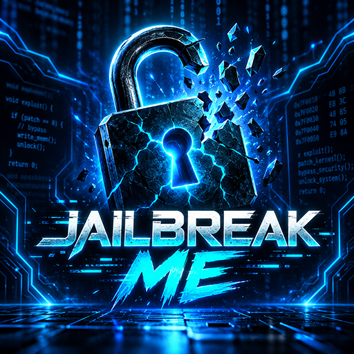

<p align="center">
  
</p>

# JAILBREAK ME — PS5 Cyber Fastboot v0.4.0

**PS5 Game-home-screen WebKit Autoloader** with a Cyber Pirate installer and exploit interface, faster first-screen display, custom icon, 4K Game Hub background, and Home Screen selection music.

Based on **[itsPLK/ps5-webkit-autoloader v0.4.0](https://github.com/itsPLK/ps5-webkit-autoloader/tree/v0.4.0)**. Original WebKit exploit support and logic belong to the upstream open-source project; this fork's changes are primarily the PS5 Game launcher identity, UI, presentation metadata and installation packaging. Distributed under **GPL-3.0**; credit and license are preserved. This is an independent homebrew fork, not official Sony software.


## Downloads

**[Releases](https://github.com/Yahballon/JB_AUTOLOADER/releases)** · [Automated builds](https://github.com/Yahballon/JB_AUTOLOADER/actions/workflows/release.yml) · [Source patches](homebrew/ps5-webkit-autoloader-game/)

| Release file | What it is | Installation |
|---|---|---|
| `JAILBREAK-ME-CYBER-FASTBOOT_v0.4.0.elf` | Actual tested WebKit Autoloader installer | **Recommended**: run using elfldr / Payload Manager on an already-jailbroken PS5 |
| `JAILBREAK-ME-host_v0.4.0.py` | PC-side upstream-compatible first-time setup host | See original upstream setup guide |
| `WKAG00001-JB-STORE-EXPERIMENTAL.zip` | Game shortcut assets, offline web resources, installer ELF and machine-readable manifest for future JB Store integration | **Not yet directly installable by the stock JB Store** |
| `SHA256SUMS.txt` | Checksums for release assets | Integrity verification |

> **Important:** The experimental JB Store ZIP is **not a real PKG/fPKG** and it has no native `eboot.bin`. Simply extracting its files does not register the Game launcher or populate the WebKit browser cache. It is provided now for **JB Store integration development**, not presented as a currently working one-click installer. See [Store integration](#jb-store-installation-and-package-format).

## Features

- Native PS5 **Game** entry, named **JAILBREAK ME** (Title ID `WKAG00001`), separate from the original Media launcher `WKAL00001`.
- Automatically loads the appropriate underlying supported exploit flow from PLK's WebKit Autoloader (no menu actions to press).
- Modern Cyber Pirate installer UI and offline exploit UI: status cards, logs, local firmware/chain status, no sidebar or fake buttons.
- Removes the redundant timed splash and reveals exploit progress **before** navigating the exploit iframe. This reduces **UI delay**; the exploit itself can still take variable time.
- Custom `icon0.png`, `pic0.dds` / `pic1.dds` (4K BC7), and `snd0.at9` (looped PS5 Home Screen selection audio).
- Maintains the existing exploit/cache/payload logic, app title identity, and PS5 Game presentation registration.

## Install on an already-jailbroken PS5

1. Download and extract the latest release **ELF** file.
2. Start it using your existing elfldr or PS5 Payload Manager.
3. Wait for the JAILBREAK ME **installation complete** screen; the Game shortcut should be registered and WebKit content cached.
4. Power off and boot the PS5 once to refresh Home Screen art. Find **JAILBREAK ME** under **Games**.
5. Select the Game tile to auto-launch the browser exploit.

The offline exploit runs automatically when launched from the tile. Some firmware/exploit paths may display transient Sony memory dialogs or take a variable amount of time; shorter UI delay does not change the race/heap behavior of the underlying exploit.

For compatible firmware ranges and first-time PC-based setup, see the [upstream documentation](https://github.com/itsPLK/ps5-webkit-autoloader#setup-instructions). Firmware information displayed by the app reflects the actual detected firmware when available; no firmware version is hardcoded.

## JB Store installation and package format

**Yes, a future JB Store integration could install this without you manually opening an ELF loader.** However, the store must implement one of the following:

- Run the included installer/helper inside an already jailbroken privileged execution context, and let it register the shortcut/cache automatically.
- Implement its own compatible native registration of `WKAG00001` (the `/user/app` and `/user/appmeta` files, the corresponding app database records, and WebKit's one-time offline AppCache population).

The second approach needs a dedicated store handler, not just a generic ZIP extractor. The Store bundle contains:

```text
WKAG00001/
  icon0.png
  sce_sys/
    param.json
    icon0.png
    pic0.dds
    pic1.dds
    snd0.at9
installer/
  JAILBREAK-ME-CYBER-FASTBOOT_v0.4.0.elf
offline/
  ... versioned and unversioned frontend content for offline caching ...
store/
  manifest.json
README-INSTALLATION.txt
```

The `store/manifest.json` explicitly identifies this bundle as **not a fake package and not stock-store directly installable**. If a JB Store update gains this integration, it can use the bundled installer and assets without asking the user to launch the ELF manually. No one-click compatibility has been claimed or hardware-verified yet.

## Reproducible source and automated releases

Everything needed to **recreate our modifications** is in this repository: [source patch scripts](homebrew/ps5-webkit-autoloader-game/), bundled custom artwork/audio, [JB Store ZIP builder](tools/package_store_bundle.py), and [the GitHub Actions build/release workflow](.github/workflows/release.yml).

The workflow fetches the original upstream repository pinned to commit `137f065d2ba8022ba8e796895e7cb05c204f2ce9` (v0.4.0) with submodules, builds the upstream PS5 SDK Docker image, encodes the user-provided song and background, applies the published source patches, verifies the native ELF, creates both distribution formats, and publishes a versioned GitHub Release.

The initial CI run also imports the custom images and audio from the already-public working test repo at a **pinned commit**, verifies their Git blob hashes, and commits them here so future builds no longer depend on the test repo. The implementation is thus reproducible from documented open-source inputs.

### Development notes

- **Title ID:** `WKAG00001` (Game); original Media shortcut `WKAL00001` is not modified.
- **Version:** WebKit Autoloader v0.4.0; Game Hub metadata content version 01.000.003.
- **UI:** offline static HTML, CSS and JavaScript, styled by reproducible patch scripts.
- **Store bundle:** experimental developer artifact; see its embedded README before attempting integration.
- **Security:** do not manually edit your PS5 system app database or clear the working browser cache to install this bundle.
- **Licensing:** original author [PLK / itsPLK](https://github.com/itsPLK/ps5-webkit-autoloader), GNU GPL v3; additional libraries/encoders retain their respective upstream licenses. Publish/redistribute soundtrack assets only if you hold the necessary rights.

## Credits

- **Original project:** [itsPLK/ps5-webkit-autoloader](https://github.com/itsPLK/ps5-webkit-autoloader) — WebKit exploit, installation, Payload Manager / autoload mechanisms.
- **JAILBREAK ME fork:** custom PS5 launcher category, Home Screen art and audio, Cyber Pirate installer/exploit UI, Fastboot splash timing, store integration prototype.
- **Encoding tools:** [ps5-at9-converter](https://github.com/blackbearreloaded/ps5-at9-converter), [bc7enc_rdo](https://github.com/richgel999/bc7enc_rdo).
